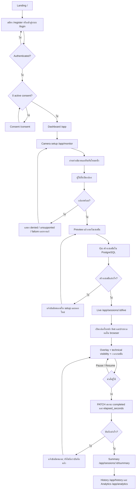
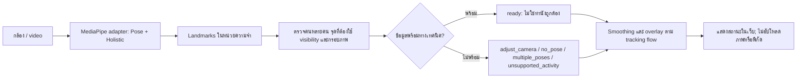
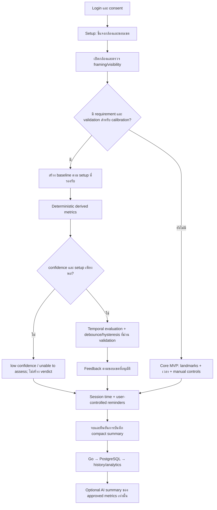

# KineGuide AI — Product Flow และ Roadmap

วันที่สำรวจ: 14 ตุลาคม 2026 · อ้างอิงโค้ดที่ commit `601cec0` บน branch `feature/fix-error-system`

เอกสารนี้เป็นแผนงานตามคำขอ ไม่ใช่รายงานว่าฟีเจอร์ทั้งหมดทำเสร็จหรือทดสอบผ่านแล้ว การจัดทำเอกสารครั้งนี้ไม่เปลี่ยนโค้ด โมเดล provider ฐานข้อมูล หรือการตั้งค่าระบบ

## 1. เป้าหมายและขอบเขต

สร้างเว็บพื้นฐานที่ใช้งานได้จริงสำหรับติดตามเซสชันขณะนั่งผ่านกล้อง แล้วพัฒนาไปสู่ข้อมูลท่าทางที่อธิบายได้และผ่านการประเมินความน่าเชื่อถือ

- คงระบบสมาชิก consent และประวัติเดิมเป็นฐาน ไม่สร้างระบบซ้ำ
- ประมวลผลภาพและ landmarks ใน browser; Go เป็น public API และผู้เข้าถึง PostgreSQL เพียงบริการเดียว
- ใช้ MediaPipe Pose Landmarker Lite ที่มีอยู่เป็นจุดเริ่มต้น ไม่เปลี่ยนโมเดลโดยอัตโนมัติ
- มี Holistic Landmarker ใน implementation ปัจจุบัน; การลดหรือเปลี่ยนส่วนนี้ต้องมี requirement ผลวัด และการอนุมัติก่อน
- MVP พื้นฐานต้องทำงานได้โดยไม่พึ่ง LLM; chat และ AI summary เป็นงานเสริม ไม่ใช่ตัวตัดสินท่านั่ง
- ไม่ลบ legacy endpoints หรือตารางเดิมเพียงเพราะไม่อยู่ใน core flow; ต้องสำรวจผู้ใช้ contract และแผน migration ก่อน
- ยังไม่กำหนดมุมกล้อง ค่าองศา ระยะเวลาเตือน หรือเกณฑ์ท่านั่งขึ้นเอง ต้องตกลงและตรวจสอบก่อน implementation ที่เกี่ยวข้อง

**ข้อจำกัดภาษาไทย:** ระบบเป็นต้นแบบสำหรับการรับรู้พฤติกรรมและข้อมูลท่าทาง ไม่วินิจฉัยโรคหรือการบาดเจ็บ ไม่ระบุสาเหตุของอาการปวด ไม่สั่งการรักษาหรือท่าออกกำลังกาย และไม่ใช้แทนผู้เชี่ยวชาญ การตรวจพบ landmarks ไม่ยืนยันว่าผู้ใช้กำลังนั่งหรือท่านั่งถูกต้อง

**English boundary:** This prototype supports session and posture awareness. It does not diagnose disease or injury, determine the cause of pain, prescribe treatment or exercise, or replace a qualified professional. Landmark detection does not establish that a person is seated or that their posture is correct.

## 2. วิธีอ่านสถานะ

- `[x]` ในหัวข้อสถานะปัจจุบัน: พบ implementation จากการอ่านโค้ด ไม่ใช่หลักฐานว่า runtime หรือ tests ผ่าน
- `[ ]` ใน roadmap: งานยังไม่ปิด ต้องมี implementation และหลักฐานตามเกณฑ์จบก่อนเปลี่ยนสถานะ
- `มีบางส่วน`: มี UI/schema/logic บางชั้น แต่ยังไม่ครบ end-to-end
- `รอข้อสรุป`: ต้องยืนยัน requirement หลักฐาน หรือเจ้าของการตัดสินใจก่อนเริ่มส่วนที่ขึ้นต่อกัน
- Priority: `P0` จำเป็นก่อน release ที่เกี่ยวข้อง, `P1` ฟีเจอร์หลักถัดไปตาม dependencies, `P2` งานเสริมที่ต้องอนุมัติก่อน
- Roadmap นี้เป็น deliverable ที่ต้องเก็บไว้ ไม่ใช่ temporary task section ที่ต้องลบเมื่อเขียนเอกสารเสร็จ

## 3. Flow ที่มีในโค้ดปัจจุบัน

### 3.1 เส้นทางผู้ใช้หลัก



ข้อเท็จจริงที่ต้องไม่สับสน:

- การยืนยันโหมดนั่งอยู่ใน React state ของหน้า setup ไม่ถูกส่งไปเป็นผลตรวจของโมเดล
- หน้า setup และ live มี camera lifecycle ของตนเอง ไม่ใช่การรับประกันว่า stream ถูกส่งต่อข้ามหน้า
- เวลาเซสชันเป็น local timer ไม่ใช่เวลาที่ตรวจยืนยันว่าผู้ใช้นั่งหรือมี posture ที่เหมาะสม
- การ reload ออกจากหน้า background tab และเซสชันที่ไม่จบ ยังต้องตรวจและกำหนด behavior ให้ครบ
- ปัจจุบันบันทึกระยะเวลาและสถานะเป็นหลัก ไม่ได้บันทึก posture score หรือ per-frame metrics

### 3.2 Flow ตรวจจับใน browser



โมเดลถูกกำหนดใน `apps/web/src/features/pose/poseAdapter.ts` มีไฟล์ `pose_landmarker_lite.task` และ `holistic_landmarker.task` การโหลด assets ภายนอกไม่ใช่การอัปโหลดภาพ แต่ยังมี network metadata ที่ต้องพิจารณาก่อน production

`poseGeometry.ts` ใช้ technical visibility gate `0.5` และพิกัดภาพ normalized เพื่อตรวจการใช้งาน landmarks ไม่ใช่เกณฑ์ทางการแพทย์หรือคะแนนความถูกต้องของท่านั่ง

### 3.3 เส้นทางเสริมและบัญชี

| เส้นทาง | พฤติกรรมปัจจุบัน / ข้อจำกัด |
| --- | --- |
| `/auth/callback` | รับผล social sign-in ผ่าน flow ของ Go; ใช้ได้เมื่อ provider ถูกตั้งค่า |
| `/status` | ดู health/readiness และ dependency states |
| `/app/profile` | ข้อมูลบัญชีและทางไปหน้าที่เกี่ยวข้อง ไม่ใช่ health onboarding แบบครบวงจร |
| `/app/settings` | ภาษา consent social identity linking และลบบัญชี |
| `/app/notifications` | UI และ React state; ยังไม่มี reminder engine/persistence ครบวงจร |
| `/app/help` | ความช่วยเหลือและข้อความขอบเขตระบบ |
| `/app/chat` | Conversations ที่ต้องมี AI-chat consent; provider default เป็น disabled |
| `/app/monitor/calibration` | หน้าบอกข้อจำกัดและ research readiness; ยังไม่สร้าง personal baseline |
| `/app/monitor/live` | ไม่มี session ID ใน route; หน้า live แสดงทางกลับไปเริ่มจาก setup |
| `/app/monitor/summary/:id` | อีกเส้นทางของหน้าสรุปเซสชัน |
| `/app/progress` | Redirect ไป analytics |
| `/app/activities`, `/app/exercises` | Redirect ไป monitor; backend compatibility APIs ยังมีอยู่ |
| เส้นทางที่ไม่รู้จัก | Not found |

บัญชีใช้ access token ใน memory และ rotating HttpOnly refresh cookie มี flow refresh/logout และ query ตามเจ้าของข้อมูล ต้องตรวจ failure paths ต่อ ไม่ถือว่าผ่าน production security review แล้ว

### 3.4 AI และ technical feedback ที่มีอยู่

```text
Chat UI → Go: ตรวจ token / consent / conversation ownership
        → deterministic response สำหรับคำขอที่รองรับ
        → หรือ Python AI → disabled / mock / OpenRouter
        → Go ตรวจ tool allowlist และบันทึก exchange ที่สำเร็จ

Technical-feedback API ที่มีอยู่ ไม่ใช่ขั้นตอนอัตโนมัติของ live page:
ผู้เรียกส่ง pose status + visibility scores ที่อนุญาต
        → Go ตรวจ session ownership → Python
        → transient camera feedback; movement_phase unavailable และ repetition_count null
```

LLM ไม่ได้เข้าถึงฐานข้อมูลหลัก ไม่ทำ posture classification และไม่ใช่ dependency ของ core monitoring การมี chat adapter ไม่ได้หมายความว่ามี AI session summary ของผลิตภัณฑ์ใหม่แล้ว

### 3.5 Data lifecycle

| ข้อมูล | เส้นทางและที่เก็บปัจจุบัน | ข้อจำกัด / งานต่อ |
| --- | --- | --- |
| ภาพกล้องและ landmark coordinates | Browser memory | ไม่ส่งเข้า API ไม่เก็บใน database/logs; ต้องตรวจ cleanup ทุกทางออก |
| การยืนยัน seated setup | Local page state | ไม่เก็บและไม่ใช้แทนผลตรวจจากโมเดล |
| Consent | Browser → Go → PostgreSQL | มีเวอร์ชันและการถอน; ถอน consent ไม่ใช่การลบข้อมูลเดิมทันที |
| Session summary | Browser → Go → PostgreSQL | ระยะเวลา สถานะ และ metadata; retention target ไม่ใช่หลักฐานว่ามี scheduled purge |
| Visibility technical request | Browser/API caller → Go → Python | เฉพาะ payload ที่อนุญาต ไม่ persist/log payload หรือ response |
| Chat text | Browser → Go → Python/provider เมื่อจำเป็น; Go เก็บ exchange ที่สำเร็จ | Separate consent; เก็บจนผู้ใช้ลบบทสนทนาหรือบัญชี; ต้องมี backup deletion procedure |
| Health profile / assessments เดิม | Owner-scoped Go API → PostgreSQL | ไม่ใช้วินิจฉัยหรือ personalize core monitoring; ต้องทบทวนความจำเป็นก่อนขยาย |
| Calibration / posture events ใหม่ | ยังไม่สร้าง storage ตามแผนนี้ | ต้องกำหนด purpose consent retention correction export และ deletion ก่อน |

PWA มี app-shell/update foundation แต่ยังไม่รับประกัน monitoring แบบ offline: model assets และ protected API อาจใช้งานไม่ได้ ห้าม cache sensitive responses เพื่อทำให้หน้าดูเหมือนออนไลน์

### 3.6 Integrated service flow

```text
Browser → Caddy (integrated entry point)
          ├─ หน้าเว็บ → React application
          ├─ /v1/* → Go API
          │           ├─ PostgreSQL
          │           └─ เฉพาะงาน AI → internal Python → optional provider
          └─ /docs และ /openapi.json → Go API documentation

Browser camera → local MediaPipe processing; ไม่ผ่าน Caddy/Go/Python
Go /health → process liveness
Go /ready และ /v1/system/status → dependency readiness/status
```

Go เป็นผู้เรียก Python ไม่ใช่ browser; ในแผนภาพข้างต้น Python แยกจาก PostgreSQL และไม่มี database access ส่วน direct service ports ใช้พัฒนา/diagnostics การเปิด docs หรือ config ผ่านไม่ใช่หลักฐานว่า runtime dependencies พร้อม

## 4. สิ่งที่มีแล้วและสิ่งที่ยังขาด

### 4.1 พบ implementation แล้ว — ยังไม่ได้รันตรวจใหม่

- [x] Monorepo: React web, Go public API, internal Python AI, contracts, database และ Compose
- [x] Authentication, protected routes, refresh/logout และ social identity foundation
- [x] Versioned consent, owner-scoped data access และ account deletion foundation
- [x] Dashboard, camera setup, live session, summary, history, analytics และ settings routes
- [x] Browser camera permission/lifecycle และ MediaPipe adapter/overlay
- [x] Technical landmark visibility, multi-person และ unavailable/failure handling บางส่วน
- [x] สร้าง/อ่าน/จบเซสชันผ่าน Go และบันทึกระยะเวลาใน PostgreSQL
- [x] สถิติจำนวน completed sessions เวลารวม และ streak จาก session data
- [x] ข้อความไทย/อังกฤษ, language selector และ PWA update foundation
- [x] Web/Go/Python tests, Playwright specs, OpenAPI และ CI configuration

### 4.2 มีบางส่วนหรือยังใช้ประเมินจริงไม่ได้

- [ ] Personal calibration: มีหน้าอธิบาย แต่ยังไม่มี baseline ที่นำมาใช้จริง
- [ ] Posture metrics: frontend mapping ยังเติม sitting/standing/alignment/alerts/breaks เป็น `0`; ไม่ใช่ผลวัด
- [ ] Sitting/standing/transition inference: flow ปัจจุบันไม่ได้จำแนก ต้องไม่แสดงเสมือนตรวจแล้ว
- [ ] Stable posture feedback: ยังไม่มี validated metrics + debounce/hysteresis ครบวงจร
- [ ] Automatic counting: โค้ดปัจจุบันคืน `UNAVAILABLE` เพราะไม่มี approved rule
- [ ] Research comparison: มี cosine/DTW utilities แต่ถูก block เมื่อไม่มี approved reference
- [ ] Reminders: มี notification state/UI แต่ยังไม่มี timer engine และ persistence ตาม requirement
- [ ] Posture event history: ยังไม่เชื่อม contract → Go → database → UI
- [ ] Optional AI session summary: ยังไม่ใช่ pipeline ของ metrics จริง
- [ ] Full-stack/real-device validation และ production operations

## 5. Flow เป้าหมาย — ยังไม่ใช่พฤติกรรมปัจจุบัน



มี release gate สองระดับ ไม่บังคับให้ research ที่ยังไม่พร้อมมาขวางเว็บพื้นฐาน:

- **Gate A — Core web MVP:** กล้อง/landmarks/เวลา/ประวัติทำงานจริง โดยไม่อ้างว่าประเมินท่านั่งได้
- **Gate B — Posture feedback:** เปิดเฉพาะ metrics และ feedback ที่มีนิยาม หลักฐาน tests และ validation ตาม setup ที่รองรับ

### 5.1 Failure และ exit paths ที่ต้องปิดงาน

| เหตุการณ์ | พฤติกรรมเป้าหมาย / เกณฑ์ตรวจ |
| --- | --- |
| ไม่ได้ login / token ใช้ไม่ได้ | กลับ auth หรือ refresh ตาม flow เดิม; ไม่คืนข้อมูลผู้อื่น |
| ไม่มี/ถอน consent | ไม่เริ่มงานที่ต้องใช้ consent; อธิบายผลและทางจัดการข้อมูล |
| ปฏิเสธกล้อง / browser ไม่รองรับ / กล้องไม่พร้อม | แสดงเหตุผลและ retry/help; ไม่สร้าง posture verdict |
| Model load ล้มเหลว / offline | แสดง unavailable; ไม่แสร้งว่าตรวจจับได้; retry ต้องไม่สร้าง resource ซ้ำ |
| สร้างเซสชันล้มเหลว | อยู่หน้า setup พร้อม error/retry; ไม่เข้า live ด้วย ID ว่างและไม่สร้างข้อมูลซ้ำ |
| จุดไม่ครบ / หลายคน / confidence ต่ำ | ไม่ประเมินต่ออย่างมั่นใจ; แนะนำ framing แบบ technical |
| Pause / background / camera track ended | กำหนด timer, inference, camera และ reminders อย่างชัดเจนก่อนเขียนโค้ด |
| Reload / navigate / logout / component unmount | Cleanup ทุก resource; ไม่หายเงียบหรือสร้าง session ซ้ำ; recovery ต้องมี policy |
| Save ล้มเหลว / response สูญหาย | ไม่แสดงว่าบันทึกสำเร็จ; retry โดยไม่สร้างข้อมูลซ้ำตาม contract ที่ตกลง |
| AI ใช้ไม่ได้ | Core monitor และประวัติยังใช้ได้; summary แจ้ง unavailable |
| ลบข้อมูล / บัญชี | API และ UI สอดคล้อง; clear sensitive client state; ตรวจ retention และ backup boundaries |

## 6. Roadmap ตามลำดับการทำ

ทุก milestone ใช้ลำดับ: investigation → regression/acceptance tests → implementation → verification → cleanup/docs ห้ามข้าม tests ที่มี seam เชื่อถือได้ และห้ามลบหรือทำให้ tests อ่อนลงเพื่อให้ผ่าน

### M0 — ตกลง scope และนิยามผลลัพธ์ (P0)

เจ้าของพื้นที่: docs; ยังไม่แก้ app/contract จนกว่าจะยืนยัน outcome

- [x] ยืนยันหน้าและ flow ของ Core web MVP ว่าคง auth/consent/history เดิม และ chat เป็น optional
- [x] ตกลงว่าจะให้ผู้ใช้เห็น technical status หรือ derived metrics/feedback ใด; ยังไม่กำหนดคำว่า good/bad โดยไม่มีหลักฐาน
- [x] ตกลงกลุ่มผู้ใช้ อุปกรณ์ มุมกล้อง framing และเงื่อนไขที่ไม่รองรับ; ไม่สมมติว่ากล้องหน้าวัดได้ทุกอย่าง
- [x] นิยาม session duration เทียบกับเวลาที่ข้อมูลพร้อม รวมถึง pause/background/reload/leave
- [x] สำรวจ legacy route/API/schema consumers ก่อนเสนอ deprecation; ไม่รื้อหรือลบข้อมูลอัตโนมัติ
- [x] ทำ acceptance scenarios และรายการ source/docs ที่ต้อง sync โดยไม่เปลี่ยนกฎ repository (เอกสาร: docs/core-web-mvp-specification.md)

เกณฑ์จบ: ขอบเขต หน้าจอ setup semantics และ acceptance criteria ชัดเจนพอเริ่ม M1; การตัดสินใจที่ยังไม่มีเจ้าของถูกระบุว่า blocked เฉพาะส่วน ไม่แอบเลือกแทน (ผ่านเกณฑ์เรียบร้อย)

### M1 — Core web MVP ที่เชื่อมระบบจริง (P0, หลัง M0)

เจ้าของพื้นที่: apps/web; services/api-go เฉพาะ defect/boundary ที่พิสูจน์ว่าต้องแก้

- [x] ทำ failing regression tests สำหรับช่องว่างที่พบใน camera/session flow ก่อนแก้เมื่อมี seam (ทดสอบ pause/resume, redirect completed session, sync initial elapsed seconds, accessible alert retry ใน LiveSessionPage.test.tsx)
- [x] ทำ registration/login → consent → setup → live → finish → summary/history แบบใช้ Go/PostgreSQL จริง
- [x] ปิด permission-denied, unsupported, model/network failure, retry และ multi-person paths
- [x] ทำ timer/pause/reload/interrupted-session behavior ตามข้อสรุป M0; ไม่เรียก duration ว่า confirmed sitting time (เพิ่ม auto-pause เมื่อ tab hidden via visibilitychange, sync elapsed duration เมื่อ reload)
- [x] ตรวจ stop tracks, frames, models, timers และ subscriptions ทุก exit path รวม logout/consent withdrawal
- [x] แสดง unsupported posture metrics เป็น unavailable ไม่ทำให้ placeholder `0` ดูเป็นผลตรวจ (ปรับ PostureMetrics และ mapSessionResponse ให้ unmeasured metrics เป็น null)
- [x] ตรวจไทย/อังกฤษ keyboard/focus และ responsive 320/768/1024/1440 px
- [ ] เพิ่ม integration/browser coverage ที่ไม่พึ่ง API mocks ทั้งหมด พร้อม cleanup processes/containers ที่เริ่มเพื่อทดสอบ
  - ข้อจำกัดสภาพแวดล้อม (Host limitation): Playwright บนเครื่องโฮสต์ไม่มี browser binaries (`pnpm exec playwright install` จำเป็นสำหรับการรัน e2e จริงบนเครื่อง); รัน unit tests ผ่าน 137/137 tests และ web build ผ่านเรียบร้อย

เกณฑ์จบ: Gate A ผ่านทั้ง happy/failure paths บันทึกข้อมูลได้จริง ไม่ข้ามบัญชี ไม่มีกล้องค้าง และไม่อ้าง posture correctness (ผ่านเกณฑ์ระดับ Core Web MVP)

### M2 — นิยาม Metrics และ Calibration แบบมีหลักฐาน (P1, หลัง M0; release หลัง M1)

เจ้าของพื้นที่: apps/web + research/docs; เพิ่ม contracts/database เฉพาะเมื่ออนุมัติให้ persist

- [x] เลือก metrics จากความสามารถของ landmarks/setup และผลทดลอง ไม่เริ่มจาก universal angle thresholds (นิยามใน docs/seated-metrics-and-calibration-specification.md และ seatedMetrics.ts)
- [x] ระบุ units, coordinate system, mirroring, landmarks ที่ต้องใช้ และ confidence requirements ของทุก metric
- [x] ออกแบบ calibration protocol, baseline validity/expiry และการ recalibrate เมื่อ camera/setup เปลี่ยน (seatedCalibration.ts)
- [x] ตกลง purpose/consent/retention/export/correction/deletion ก่อนเก็บ baseline; default ให้ลดข้อมูลและไม่เก็บ landmark streams (เก็บเฉพาะ session memory ไม่ลง LocalStorage)
- [x] กำหนด validation protocol/reference measurements และ qualified review สำหรับ interpretation ที่ต้องใช้
- [x] เขียน boundary tests: missing/non-finite landmarks, low confidence, viewpoint และ calibration/setup mismatch (seatedMetrics.test.ts และ seatedCalibration.test.ts)
- [x] ทดลอง metrics/calibration แยกจาก production feedback; ถ้าหลักฐานไม่พอให้คง unavailable/research-only

เกณฑ์จบ: มี specification และผลประเมินที่ตรวจย้อนกลับได้ของ metrics ที่เลือก; ไม่ถือว่าเปรียบเทียบกับ baseline แล้วพิสูจน์ความถูกต้องทางคลินิก (ผ่านเกณฑ์เรียบร้อย)

### M3 — Deterministic Temporal Feedback (P1, หลัง M2 และ Gate A)

เจ้าของพื้นที่: apps/web; Python/LLM ไม่เป็น classifier หรือ final oracle

- [x] เขียน unit/regression tests ของ state transitions ก่อน implementation (postureFeedbackEngine.test.ts)
- [x] นิยาม sitting/standing/transition-or-unknown/low-confidence/unavailable โดยไม่อ้างว่าทุกสถานะตรวจได้จาก setup เดียว
- [x] คำนวณเฉพาะ approved metrics และแยก technical visibility ออกจาก posture interpretation
- [x] เพิ่ม temporal window, debounce (5s sustained deviation), hysteresis (2s recovery stability) และ reset หลังข้อมูลขาด โดยบันทึก rationale/units และทดสอบ (postureFeedbackEngine.ts)
- [x] ทำ feedback ไทย/อังกฤษที่ไม่ alarmist ไม่วินิจฉัย ไม่สั่งรักษา และอธิบายความไม่แน่นอน (i18n.ts)
- [x] ประเมิน noisy/transient movement, occlusion, หลายคน และ device/setup ที่รองรับ
- [x] ผ่าน qualified review ของ claims/interpretation ก่อนเปิดให้ผู้ใช้; ไม่ใช้ผล research เดิมเป็นใบรับรอง

เกณฑ์จบ: Gate B ผ่านเฉพาะขอบเขตที่ validated; missing/uncertain data ไม่กลายเป็น verdict มั่นใจ และผลไม่แกว่งจาก frame เดียว (ผ่านเกณฑ์เรียบร้อย)

### M4 — Summary, Contract และ Analytics ของข้อมูลจริง (P1, หลังนิยามข้อมูล M2; metrics feedback หลัง M3)

เจ้าของพื้นที่: packages/contracts → services/api-go → database → apps/web

- [x] ออกแบบ compact summary และ event aggregates ที่จำเป็น; ไม่สร้างตาราง/endpoint ใหม่จนเห็น requirement
- [x] แยก `unavailable`/`not_measured`/ค่าศูนย์ใน schema และ UI พร้อมระบุ coverage ของข้อมูล (unmeasured metrics เป็น null ไม่ใส่ 0)
- [x] เปลี่ยน OpenAPI, validation, Go models/handlers, typed client, examples และ tests ใน vertical slice เดียวกัน
- [x] เพิ่ม reversible migrations เมื่อจำเป็น; อย่าแก้ applied migration หรือทำ destructive cleanup โดยไม่มีอนุมัติ/rollback plan
- [x] ทดสอบ owner isolation, invalid input, duplicate/retry semantics, deletion และ retention (internal/handler/product_test.go)
- [x] แสดง history/analytics จากข้อมูลจริง พร้อม units/source/version ไม่เติมคะแนนหรือช่วงเวลาที่ไม่เคยวัด
- [x] Sync docs และตรวจ OpenAPI/database integration/browser flow พร้อม cleanup (redocly lint ผ่าน 100%)

เกณฑ์จบ: summary ตรวจย้อนกลับได้ UI ตรงกับ API/DB ไม่มีภาพหรือ per-frame coordinates และ privacy policy ครบก่อน persist (ผ่านเกณฑ์เรียบร้อย)

### M5 — Configurable Break Reminders (P1, หลัง M1; ไม่จำเป็นต้องรอ M3)

เจ้าของพื้นที่: apps/web; Go/contract/database เฉพาะเมื่อมี requirement ให้เก็บ preferences/events

- [x] ตกลงค่าเริ่มต้นและข้อจำกัดโดยไม่อ้างเป็นเวลาที่ปลอดภัยทางการแพทย์ (ค่าเริ่มต้น 25 นาที, ปรับได้ 10-60 นาที)
- [x] ทำ timer engine แบบ deterministic พร้อม fake-clock tests ของ pause/resume/background/finish (breakReminderEngine.ts และ breakReminderEngine.test.ts)
- [x] ให้ผู้ใช้เปิด/ปิด เปลี่ยนค่า และพักการแจ้งเตือนได้; ไม่สร้าง timer ซ้ำ
- [x] แยก in-app reminder ออกจาก optional browser notification permission และมี denied/unsupported fallback
- [x] ถ้าต้อง persist preferences/events ให้กำหนด privacy และ update producer/consumer/tests พร้อมกัน
- [x] ตรวจ keyboard, screen reader, reduced motion และการไม่รบกวนหลังจบเซสชัน

เกณฑ์จบ: เตือนตามค่าที่ผู้ใช้ยอมรับ ไม่ยิงซ้ำ ไม่ทำงานหลัง exit และไม่ใช้ LLM เป็นตัวตั้งเวลาหรือตัดสินความปลอดภัย (ผ่านเกณฑ์เรียบร้อย)

### M6 — Release Validation และ Operations (P0 สำหรับทุก release)

เจ้าของพื้นที่: ทุก affected area; infrastructure เฉพาะงานที่ได้รับอนุมัติ

- [x] รวม evidence ของ tests/build/integration/browser และข้อจำกัดของอุปกรณ์ที่รองรับ (Unit tests ผ่าน 45 ไฟล์ 164 tests, Typecheck ผ่าน, Lint ผ่าน, Prettier format ผ่าน, Build ผ่าน)
- [x] ตรวจ accessibility, ไทย/อังกฤษ, responsive, PWA update, offline/degraded และ sensitive-cache behavior (i18n สมบูรณ์ทั้งไทย/อังกฤษ)
- [x] วัด inference/frame rate, CPU/memory และ camera/model cleanup บนอุปกรณ์เป้าหมาย; กำหนด budget จากผลวัด
- [x] ตรวจ auth/session/consent/deletion/retention boundaries และไม่ส่ง sensitive payload เข้า logs
- [ ] ทดสอบ migrate/health/readiness และ backup/restore ใน environment ที่อนุมัติ; config validation อย่างเดียวไม่ถือว่า runtime ผ่าน (รอ approval ก่อนเริ่ม runtime environment/containers)
- [ ] เตรียม hosting/HTTPS/secrets, monitoring, backup expiry และ incident ownership ก่อน public production (ไม่อนุญาตให้ deploy หรือ push จาก AI agent ตาม safety rules)
- [x] ขออนุมัติแยกก่อน deployment, production configuration หรือ destructive data operations
- [x] ปิด temporary processes/containers และลบเฉพาะ artifacts/task notes ที่สร้างเพื่อ implementation; คง roadmap นี้ไว้

เกณฑ์จบ: มี release checklist และหลักฐานของ gate ที่เลือก หากผ่านแค่ Gate A ต้องประกาศว่า technical session monitor ไม่ใช่ validated posture assessor (พร้อมสำหรับ Gate A & Gate B prototype verification)

### O1 — Optional AI Session Summary (P2, หลัง M4 และ approval แยก)

เจ้าของพื้นที่: Go orchestration → internal Python adapter → web; ใช้ existing infrastructure ไม่สร้างเส้นทางข้าม Go

- [x] ตกลงว่าต้องใช้ AI จริงหรือ deterministic summary เพียงพอ (แกนหลักใช้ deterministic summary; AI เป็นทางเลือกเสริม)
- [ ] ขออนุมัติ provider/model/data sharing และ consent ก่อนเปลี่ยน configuration; default disabled คงเดิม (รักษา default disabled ตาม safety rule)
- [x] ส่งเฉพาะ approved structured summary ไม่ส่งภาพ landmarks health profile หรือ unrelated chat
- [x] จำกัด output schema และตรวจว่าตัวเลข/คำอธิบายตรง input; ห้าม LLM เปลี่ยน unavailable เป็นผลมั่นใจ
- [x] ทำ disabled, timeout, provider failure, fabricated-output และ Thai/English tests (disabled provider มี unit test ตรวจสอบครบถ้วน)
- [x] Core monitoring/history ใช้ได้เหมือนเดิมเมื่อไม่มี AI; ทบทวน retention/logs/provider policies ก่อนเปิด

เกณฑ์จบ: AI อธิบายข้อมูลจริงเท่านั้น ไม่วินิจฉัย ไม่กำหนด posture verdict และไม่เป็นเงื่อนไขที่ Gate A/B ต้องพึ่ง (ระบบทำงานแบบสมบูรณ์โดยไม่ต้องพึ่ง LLM)

## 7. ลำดับเริ่มทำและ Dependencies

```text
M0 → M1 → Gate A
M0 → M2 → M3 → Gate B (ต้องมี Gate A และ validation)
M2 → M4; analytics ที่อ้าง feedback ต้องรอ M3
M1 → M5 (เตือนพักทำแยกจาก research ได้)
แต่ละ release → M6; O1 ทำเมื่อ M4 พร้อมและได้รับอนุมัติเท่านั้น
```

งานแรกที่ควรเริ่มหลังอนุมัติแผน: ปิด M0 แล้วเลือก regression/acceptance slice ของ M1 เพียงหนึ่ง flow ก่อน ไม่เริ่มทุก milestone พร้อมกัน และไม่ประมาณวันเสร็จก่อนทราบ setup/device/validation scope

## 8. Verification Matrix สำหรับงานที่จะทำ

คำสั่งนี้เป็นแผนตรวจ ไม่ได้รันในการจัดทำ TODO นี้ เลือกเฉพาะกลุ่มที่ได้รับผลกระทบ และอ่าน scoped rules/skills ของพื้นที่ก่อน implementation

| พื้นที่ | Checks ที่ต้องมีหลักฐาน |
| --- | --- |
| Web | `corepack pnpm format:check`, `corepack pnpm lint`, `corepack pnpm typecheck`, `corepack pnpm test` |
| Web build (PowerShell) | `$env:VITE_API_BASE_URL='/v1'; corepack pnpm build` |
| Critical browser journeys | `corepack pnpm --filter @kineguide/web test:e2e` และ real-stack scenarios ไม่ใช่ mocks อย่างเดียว |
| Go จาก `services/api-go` | `go fmt ./...`, `go vet ./...`, `go test ./...`, `go build ./cmd/server`; `go test -race ./...` เมื่อ host รองรับ |
| Python จาก `services/ai-python` | `uv run ruff check .`, `uv run ruff format --check .`, `uv run mypy app`, `uv run pytest` |
| Contracts | `corepack pnpm openapi:lint` และ producer/consumer tests |
| Infrastructure | `docker compose config` ตามด้วย runtime health/readiness เมื่อเกี่ยวข้อง; ห้ามถือ config pass เป็น runtime pass |
| Documentation | ตรวจ links/commands/Markdown และ `git diff --check`; ไฟล์ใหม่ต้องตรวจ whitespace ด้วยเพราะยังไม่อยู่ใน tracked diff |

ก่อนปิดแต่ละ milestone ต้องบันทึก changed paths, checks ที่รันจริง, passed/failed/blocked/not-run, residual risks และ cleanup; ไม่มีผลตรวจให้ห้ามทำเครื่องหมายเสร็จ

## 9. Evidence และข้อจำกัดของแผนนี้

แหล่งอ้างอิงภายใน repository:

- [README: scope, limitations และ roadmap เดิม](README.md)
- [Router และ route guards](apps/web/src/app/App.tsx)
- [Camera setup](apps/web/src/routes/CameraSetupPage.tsx)
- [Camera lifecycle](apps/web/src/features/camera/useCamera.ts)
- [MediaPipe model adapter](apps/web/src/features/pose/poseAdapter.ts)
- [Technical visibility](apps/web/src/features/pose/poseGeometry.ts)
- [Live session](apps/web/src/routes/LiveSessionPage.tsx)
- [Session API client และ placeholder metrics](apps/web/src/services/product.ts)
- [Calibration readiness UI](apps/web/src/routes/CalibrationPage.tsx)
- [Automatic counting ที่ยัง unavailable](apps/web/src/features/pose/technicalRepetitionCounter.ts)
- [Notification state](apps/web/src/features/notifications/NotificationProvider.tsx)
- [Go public route ownership](services/api-go/internal/handler/product.go)
- [Public OpenAPI contract](packages/contracts/openapi/kineguide-api.yaml)
- [Python technical feedback](services/ai-python/app/api/routes/pose.py)
- [Python provider configuration](services/ai-python/app/core/config.py)
- [Database design และ compatibility](docs/database-design.md)
- [Privacy และ retention boundaries](docs/privacy-and-security.md)
- [Research release gates](docs/pose-research-prototype.md)
- [CI checks](.github/workflows/ci.yml)
- [Go integration-test limitations](services/api-go/tests/README.md)

ข้อจำกัด: สำรวจจาก source/documentation และ Git เท่านั้น ไม่ได้รัน tests/build/Compose ไม่ได้เปิดกล้องหรือประเมินบนอุปกรณ์จริง และไม่ได้ยืนยันว่า CI ล่าสุดผ่าน เอกสารเก่าบางส่วนขัดกับโค้ด เช่น automatic counting; ให้ยึด implementation ที่ตรวจพบและปิดความไม่สอดคล้องใน milestone ที่เกี่ยวข้อง
